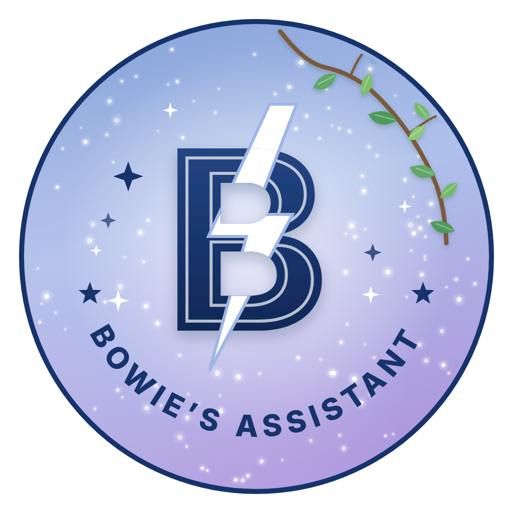

# Bowie's Assistant

The private assistant behind Bowie's Workspace & Dev Server. It builds, organises and looks after the server.

## How it works

1. Dai (or Wolf) tells Claude what they want in the server.
2. Claude writes a request into `requests/`.
3. GitHub Actions wakes the assistant, which carries out the request through Discord's API and stops again.
4. The results are saved back here in `reports/`, for Claude to read and explain.

The token lives only in the `DISCORD_TOKEN` Actions secret. It is never written in this repository, in chat or anywhere else.

## Folders

| Folder | What's in it |
| --- | --- |
| `bot/` | The assistant's code (Discord API v10, no extra libraries) |
| `requests/` | Jobs for the assistant, one file each |
| `reports/` | What the assistant found or did |
| `brand/` | The emblem, banner and the server's theme colours |
| `backups/` | A nightly copy of how the server is built (channels, roles, permissions, onboarding, rules) |
| `tests/` | Checks that run before any change reaches Discord |

## What it does

| When | What |
| --- | --- |
| Every change | Logs it in 📋・assistant-log, with who asked |
| Every night, 03:17 UTC | Backs up how the server is built |
| Every morning, 09:07 UTC | Daily prompt, song of the day, and any new Leafvella news |
| Wednesday evening | ⚡ Album of the week in the Bowie corner |
| Sunday evening | 🛡 Weekly check-up for staff |
| When asked | Builds and tidies channels, roles, onboarding, rules, AutoMod, posts and banners |

## Built-in safety

- **Nightly backup** at 03:17 UK time of the whole server structure, so anything deleted by mistake can be rebuilt, and the history shows what changed and when.
- **Code check** on every change: syntax, tests, and a scan that blocks anything that looks like a token.
- **Dependabot** keeps the GitHub Actions up to date; every action is pinned to an exact version.
- **Deleting needs a yes** from Dai or Wolf, recorded in the request.
- **Request form:** Dai or Wolf can also file a request from the GitHub app (Issues → New → Request for Bowie's Assistant).
- Every run writes a readable summary on its page in the Actions tab.

## Privacy

- This repository is public, so nothing personal is kept in it: no member names or ids, no chat, no pinned posts. Member names are never stored, only counts.
- Chat messages are never stored. Pinned posts by Dai or by bots are kept as setup context. PDFs are never stored here; they're listed by name only and live in Dai's private Drive folder.
- Nothing is deleted without Dai or Wolf saying so.
