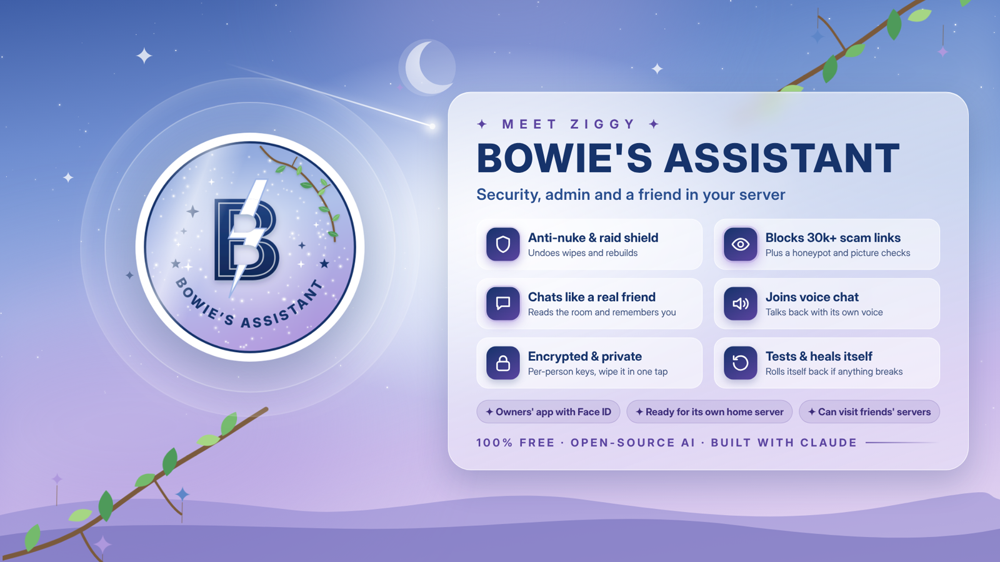

<a href="docs/readme/banner.gif">See the animated banner</a>

# Bowie's Assistant ✦ Ziggy

A private Discord assistant for one friends' server: **a security and admin bot, and a friend to talk to.** Twilight-themed, encrypted from end to end, and running entirely on free plans.

**Live:** [status](https://bowies-assistant.daibowie.workers.dev/status) · [meet Ziggy](https://bowies-assistant.daibowie.workers.dev/meet) · [the Workspace OS](https://bowies-assistant.daibowie.workers.dev/os) · **Status:** live in one server, invite only.

## How this repository fits in
- **Everything here is encrypted** (git-crypt, AES-256): the code, its settings, its word lists, its records and its history. Only the files GitHub needs to run it stay readable (`.github/`, this README, `SECURITY.md` and the public pages in `docs/`).
- **The key** lives in GitHub's encrypted Actions secrets and in the owner's private vault, nowhere else. To anyone else, the files are unreadable.
- **Nothing personal is ever stored here:** no member names, ids, chat or pinned posts. Counts only.
- **Free by design:** Cloudflare Workers (the always-on bot), GitHub Actions (building, testing, backups) and open-source models. No paid plans, no cards, no sign-ups.

## Who makes it
- **Dai** (the owner) designs it, sets the rules and tests it in his own server.
- **AI (Claude)** builds and teaches it: the code, the tests, the training and its library of worked examples.
- **The co-owner and the staff team** keep the server running and teach it from real moderation.

## Privacy and safety
- **Encrypted per person:** everything about a member is encrypted with their own key (AES-256-GCM). Working notes, settings, sign-in sessions and jobs are encrypted too.
- **Private chats stay private:** never read by anyone else, never used in public, never logged.
- **Forget me:** one command wipes a person completely.
- **Never trained on members' messages** (Discord's Developer Policy). Its teacher writes its lessons by hand.
- **Honest:** it always says it's a bot, and AI-made pictures and summaries say so.

## What it does
| Area | What it does |
|---|---|
| **Protects the server** | Scam links and fake verification tricks (30,000+ known scam sites), slurs and hate, raids, account takeovers ("nukes"), spam, impersonators, picture checks, a honeypot for spam bots, and a ladder of consequences that gets firmer each time. |
| **Looks after itself** | Tests itself every morning and before every update goes live, saves a database restore point, and rolls a bad update back by itself. Every week it audits the server (flagging, never deleting); after every update it rewrites its own command guides; every day it reads Discord's developer change log and watches its free plan limits; it restarts a skipped backup, switches paused schedules back on, and once a month proves its backups really open. |
| **Gets better on its own** | Nightly training on its own chats, a weekly exam on a research test set, lessons from the server's staff, and a daily list of moments to learn from, read by its teacher (Claude), who writes the fixes by hand. |
| **Stays honest** | Logic traps and "agree with everything" games get a straight answer, never a cave-in. |
| **Chats like a friend** | Reads the room, remembers you (if you want it to), matches your style, joins voice chat with its own voice, and fires back in roast battles. |
| **Brings people together** | Levels with streaks, achievements and a weekly crown, party games (would you rather, truth or dare, 20 questions), fair giveaways, event sign-ups, your own temporary voice room, and news, YouTube and Bluesky feeds. |
| **Answers for real** | Weather, scores, news, money, TV, space and more, looked up live from free public services, with a designed card. Picks his own lookups for questions it hasn't seen before, digs deeper into Wikipedia, checks his own numbers, and if he really doesn't know, says so and gets back to you with the answer later. |
| **Its own app** | The **Workspace OS**: a small web app for the server (guide, rules, channels, events, Ask, Space, free games, emoji, stickers and the soundboard) in fourteen languages (including Welsh, Irish, Scottish Gaelic, Arabic and Urdu), with a living twilight sky, Light and Dark modes, accessibility settings and offline support. No accounts, cookies or tracking. |
| **A staff app too** | **Workspace HQ**: the same app with a staff side behind Face ID (passkeys). What each person can do follows their real Discord role, checked every time. Alerts for serious problems only. |
| **Fits each member** | Their own choices on one panel (what it remembers, how it chats, "don't talk to me", "keep it clean with me", forget me) and their own time zone. Every GIF and picture it posts carries a description for screen readers. |
| **Looks the part** | Its own twilight emoji, stickers and original soundboard sounds, plus a bright variety pack (moods, gaming, food, animals and weather) that it adds by itself as boosts unlock room. |

## Not built yet
- **Companion mode** (planned, switched off): visiting friends' servers to chat, play and join voice, never moderating or changing anything there, in at most 20 servers its owners approve. It waits for the home server.
- **The home server:** a one-line kit for a Raspberry Pi or mini PC is ready, to run chat, voice, hearing and training on open-source models at home, while Cloudflare stays the always-on front door. The hardware comes later.
- **No daily AI limit:** until the home server is on, the free AI allowance runs out on busy days; the safety rules carry on without it.

## How it is built
| Folder | What it is |
|---|---|
| `worker/` | The live bot on Cloudflare: `worker.js` (the engine), `moderation.js` (spotting rules), `comebacks.js`, `games.js`, `lookup.js` (live answers), `upkeep.js` (the jobs that look after itself), `control.js` (Workspace HQ), `site.js` and `meet.js` (its pages), `deploy.mjs` and `verify.mjs` (the deploy guard). |
| `bot/` | Jobs run by GitHub Actions: requests, the pulse, backups, archives, the weekly exam and the free plan watch. |
| `content/` | Its words: worked examples, facts, the character bible, live test cases, GIFs and lines. |
| `os/` | The Workspace OS and Workspace HQ. |
| `brand/` | The emblem, theme, banners, emoji, stickers, sounds and the tools that make them. |
| `pi/` | The home server kit. |
| `tests/` | Over 100 checks, including a red team of disguised slurs, scams and tricks, run before every update. |
| `docs/` | The readable parts: the public status page, the variety pack and these banners. |

## Built with open-source work

Thank you to everyone whose work this bot stands on:

- **HateCheck**, Röttger et al. (2021), [paul-rottger/hatecheck-data](https://github.com/paul-rottger/hatecheck-data), CC BY 4.0, and **Multilingual HateCheck** (Röttger et al., 2022), CC BY 4.0: the weekly exam.
- **antislop-sampler**, Sam Paech, [sam-paech/antislop-sampler](https://github.com/sam-paech/antislop-sampler), Apache-2.0: the list of phrases that make writing sound machine-made.
- **Surge AI profanity list**, [surge-ai/profanity](https://github.com/surge-ai/profanity), MIT.
- **Discord scam domain lists**: [nikolaischunk/discord-phishing-links](https://github.com/nikolaischunk/discord-phishing-links) (MIT), [Phishing.Database](https://github.com/Phishing-Database/Phishing.Database) (MIT), [DevSpen/scam-links](https://github.com/DevSpen/scam-links) and [BuildBot42/discord-scam-links](https://github.com/BuildBot42/discord-scam-links) (public domain).
- **OpenPhish community feed**, [openphish/public_feed](https://github.com/openphish/public_feed), free for non-commercial use under [its terms](https://openphish.com/terms.html).
- **NSFWJS**, Infinite Red, [infinitered/nsfwjs](https://github.com/infinitered/nsfwjs), MIT: the backup picture check.
- **Detoxify**, Unitary, [unitaryai/detoxify](https://github.com/unitaryai/detoxify), Apache-2.0, run with **Transformers.js** (Hugging Face, Apache-2.0): the backup text check.
- **malware-filter** by curbengh ([urlhaus-filter](https://gitlab.com/malware-filter/urlhaus-filter), [phishing-filter](https://gitlab.com/malware-filter/phishing-filter)), built from abuse.ch URLhaus (CC0) and community phishing feeds: malware and gaming/crypto phishing domains.
- **Unicode confusables** (UTS #39), [unicode.org](https://www.unicode.org/Public/security/latest/confusables.txt), Unicode License.
- **sinking.yachts** scam database, **GamerPower** free games and **The Space Devs** Launch Library.
- Live answers from free public services: **Open-Meteo** (weather and places, CC BY 4.0), **Frankfurter** (European Central Bank rates), **BBC News** feeds, **ESPN** and **TheSportsDB**, **Wikipedia** (CC BY-SA), **TVMaze**, **MusicBrainz**, **Open Library**, **TheMealDB**, **Free Dictionary**, **Nager.Date**, **CoinGecko**, **NASA** (picture of the day), **Where The ISS At**, **CheapShark**, **icanhazdadjoke**, **NOAA** (aurora), **USGS** (earthquakes), **Jolpica** (Formula 1), **wttr.in** and **ExchangeRate-API** (backups), and the public **Bluesky** and **YouTube** feeds.
- The **Workspace OS** is built on the shell of the **Leafvella** demo (Leafvella is the owner's own app) and uses the **International Meteor Organization**'s meteor shower calendar.
- The home server kit uses **llama.cpp** and **whisper.cpp** (MIT), **Qwen3** models (Apache-2.0), **Whisper** (MIT), **Kokoro-82M** (Apache-2.0) through **kokoro-onnx** (MIT), and Cloudflare's **cloudflared** (Apache-2.0).
- Open-source AI models on Cloudflare Workers AI (Llama, Llama Guard, Gemma, Qwen, Whisper, BGE and others), each under its own licence.

Found a security problem? See [SECURITY.md](SECURITY.md).
